<div align="center">


<p>
<a href="https://www.codianstudio.org/"></a>
<a href="https://tipzpop.in/"></a>
<a href="mailto:studiocodian@gmail.com"></a>
<a href="https://t.me/codian_studio"></a>
</p>

</div>


## 👋 Hi, I'm Pankaj Kumawat

I'm an **Android, Flutter and AI developer from India** and the founder of **[Codian Studio](https://www.codianstudio.org/)**.
I design, build and ship products end to end — product thinking, UI, app code, backend, payments and the launch.
My main product is **[TipzPop](https://tipzpop.in/)**, a non-custodial UPI tipping platform for live streamers.

```kotlin
val pankaj = Developer(
    name    = "Pankaj Pourwal Kumawat",
    studio  = "Codian Studio",
    country = "India",
    stack   = listOf("Kotlin", "Jetpack Compose", "Flutter", "Firebase", "Node.js", "Python"),
    mission = "Ship real products, not just code",
)
```


## 🚀 Projects

<table>
<tr>
<td width="50%"><a href="https://www.codianstudio.org/projects/tipzpop/"></a></td>
<td width="50%"><a href="https://www.codianstudio.org/projects/codian-esports/"></a></td>
</tr>
<tr>
<td width="50%"><a href="https://www.codianstudio.org/projects/smartconnect/"></a></td>
<td width="50%"><a href="https://www.codianstudio.org/projects/pxj-ai-master/"></a></td>
</tr>
<tr>
<td width="50%"><a href="https://www.codianstudio.org/projects/whiteboard-studio-pro/"></a></td>
<td width="50%"><a href="https://www.codianstudio.org/projects/my-wish/"></a></td>
</tr>
<tr>
<td width="50%"><a href="https://www.codianstudio.org/projects/super-ai/"></a></td>
<td width="50%"><a href="https://www.codianstudio.org/projects/motion-lab/"></a></td>
</tr>
<tr>
<td width="50%"><a href="https://www.codianstudio.org/projects/ui-designer-studio/"></a></td>
<td width="50%"><a href="https://www.codianstudio.org/projects/macro-recorder/"></a></td>
</tr>
</table>

<p align="center"><a href="https://www.codianstudio.org/#apps"><b>See every project, screenshots and downloads on codianstudio.org →</b></a></p>

> The code of my products is private. Each project page has the story, features, screenshots and the **APK / Google Play / live links**.


## 📲 Download

| App | Get it |
|---|---|
| **Codian Esports** — Free Fire & BGMI tournaments | [Download APK](https://www.codianstudio.org/projects/codian-esports/) |
| **SmartConnect** — offline digital business card | [Download APK](https://www.codianstudio.org/projects/smartconnect/) |
| **UI Designer Studio** — one design, nine frameworks | [Download APK](https://www.codianstudio.org/projects/ui-designer-studio/) |
| **Macro Recorder** — record and replay taps | [Download APK](https://www.codianstudio.org/projects/macro-recorder/) |
| **Whiteboard Studio Pro** — offline whiteboard & PDF notes | [Google Play](https://play.google.com/store/apps/details?id=com.smartboard.studio.pro) |


## 🐍 Contribution snake

<div align="center">
<picture>
  <source media="(prefers-color-scheme: dark)" srcset="https://raw.githubusercontent.com/pankaj-pkj/pankaj-pkj/output/github-contribution-grid-snake-dark.svg">
  <source media="(prefers-color-scheme: light)" srcset="https://raw.githubusercontent.com/pankaj-pkj/pankaj-pkj/output/github-contribution-grid-snake.svg">
  
</picture>
</div>

## 🤝 Let's build something

Have an app, a website, a bot or an AI feature in mind?

| | |
|---|---|
| 🌐 Portfolio | [www.codianstudio.org](https://www.codianstudio.org/) |
| ✉️ Email | [studiocodian@gmail.com](mailto:studiocodian@gmail.com) · [support@codianstudio.org](mailto:support@codianstudio.org) |
| 💬 Telegram | [@codian_studio](https://t.me/codian_studio) · [@python_lovr](https://t.me/python_lovr) |

<p align="center"><sub>Pankaj Kumawat · Codian Studio · India</sub></p>
